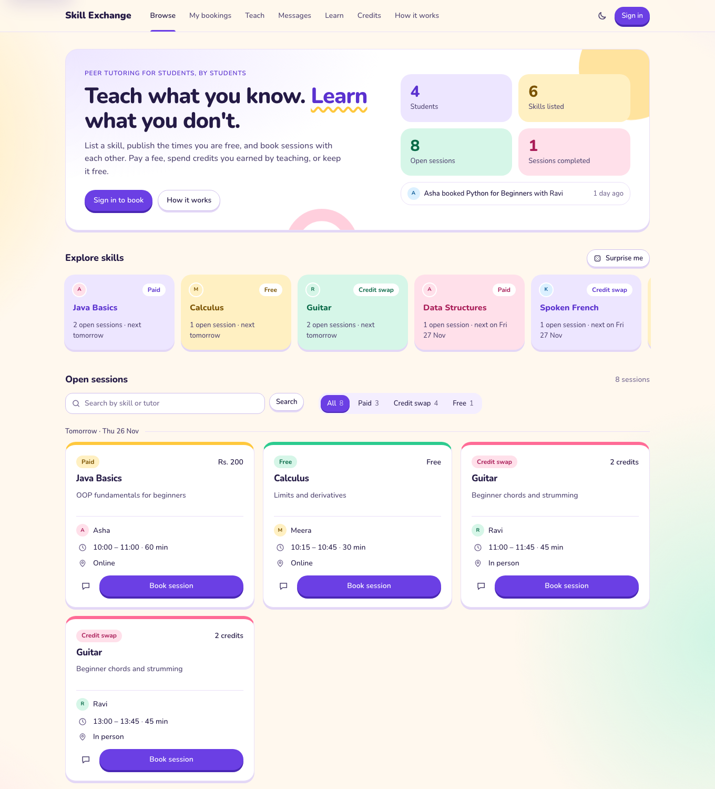
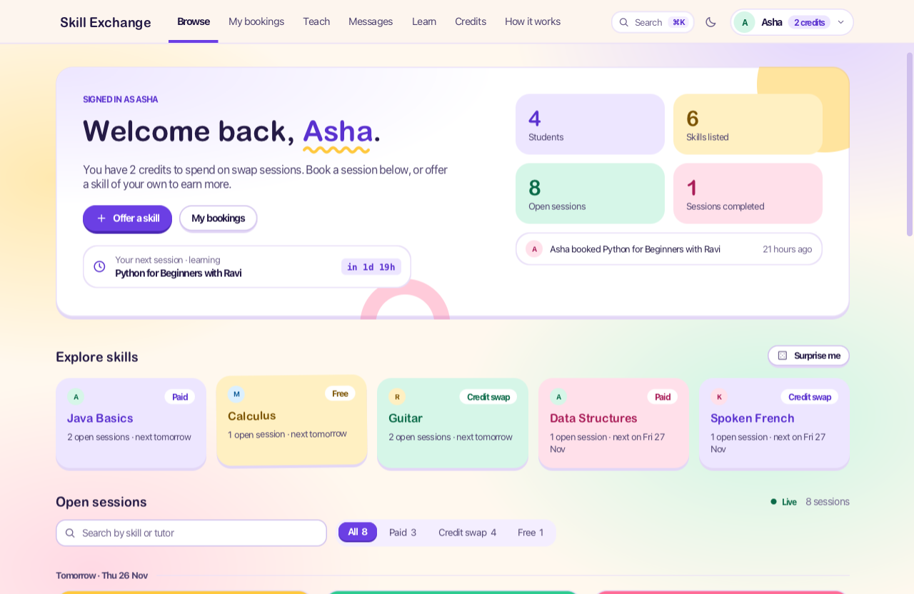
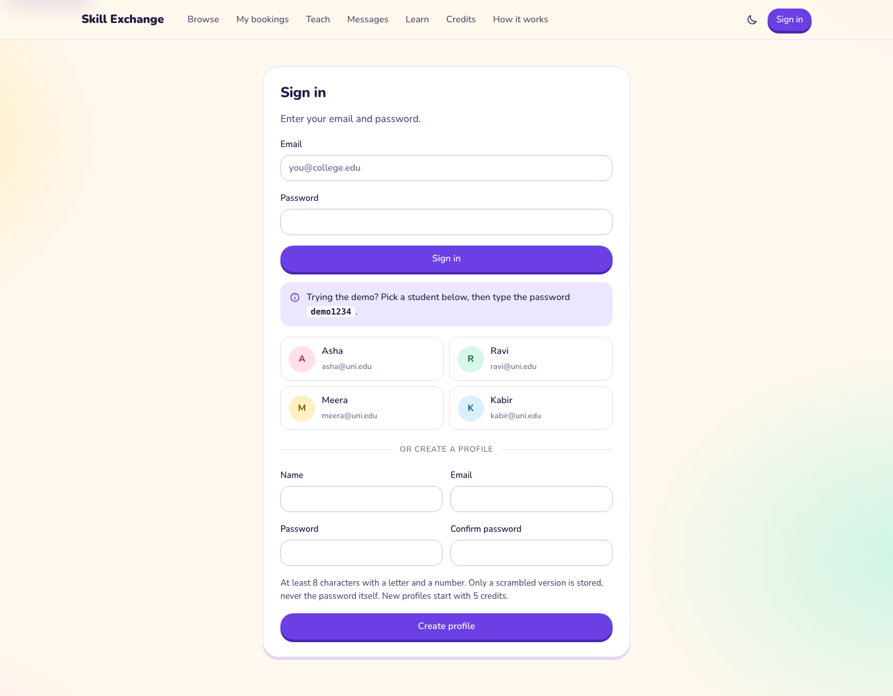
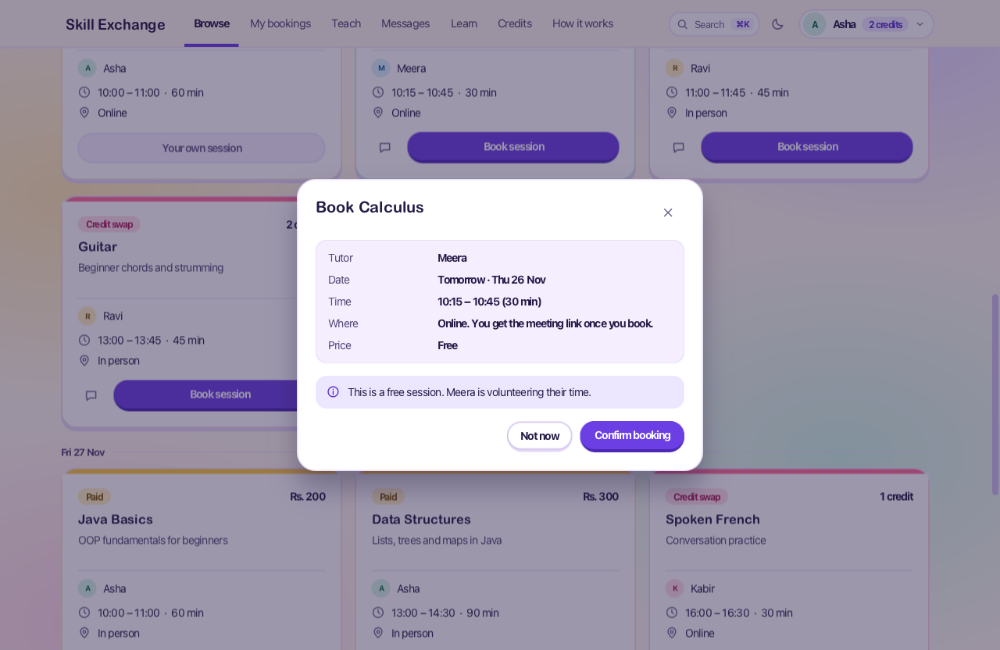
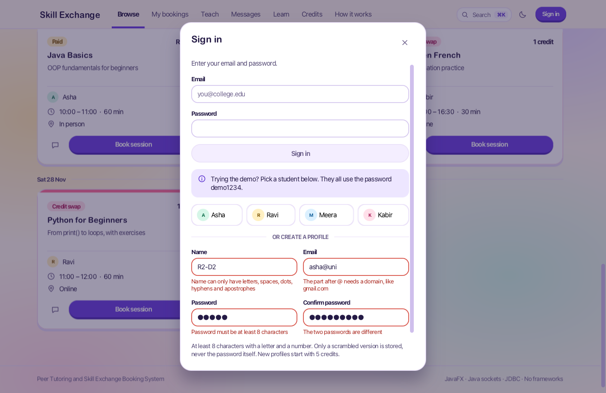
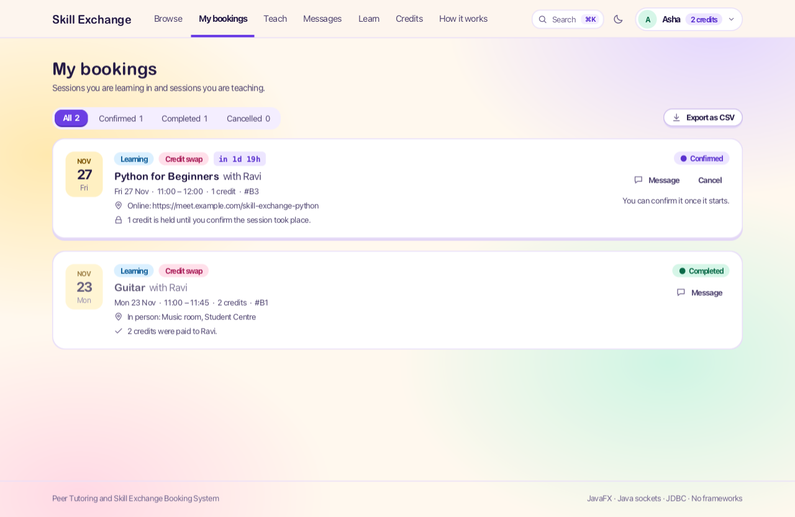
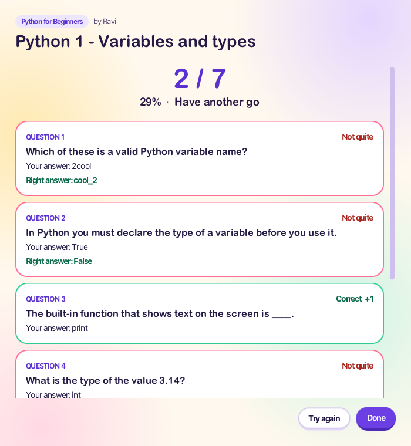
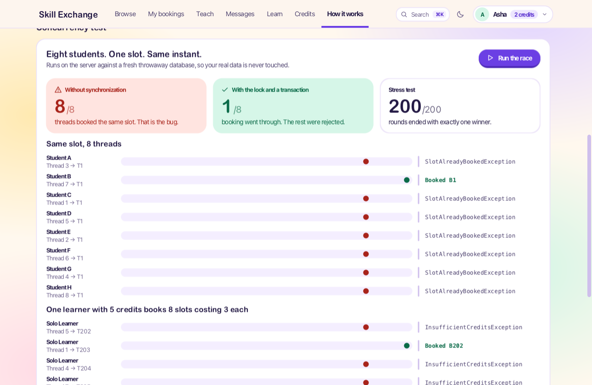
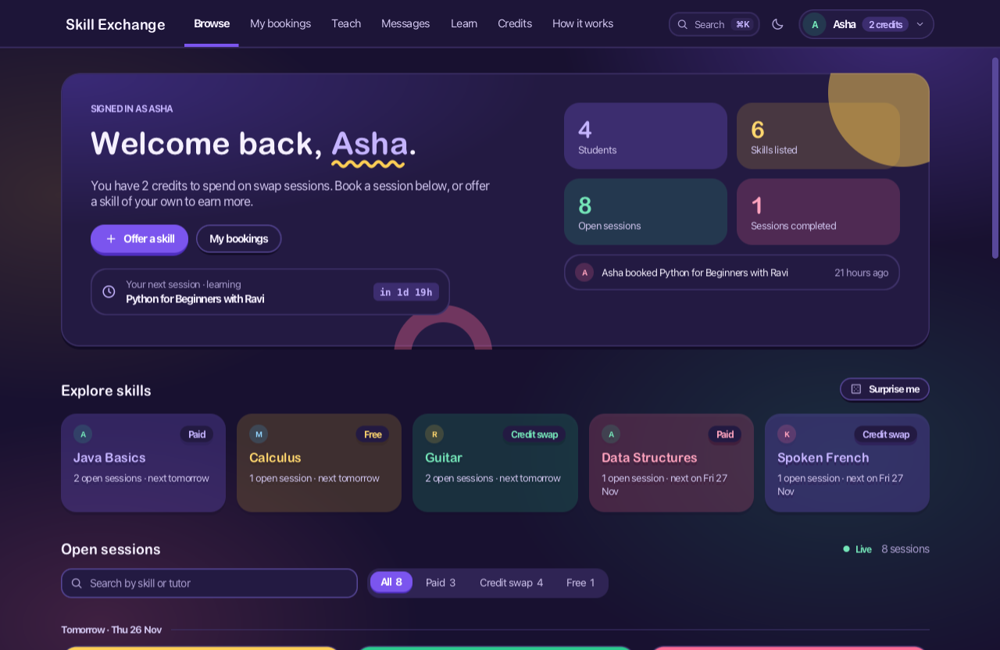

# Peer Tutoring and Skill Exchange Booking System

**UCS553 Enterprise Web Application** · Akshat Kaushik · Rudraksh Chugh

**Live: <https://skill-exchange-85tb.onrender.com>** (open it in a browser; nothing to install)

A booking system for peer tutoring, written entirely in Java. A student lists a skill, publishes
time slots, and other students book them. A session is **paid**, **free**, or a **credit swap**
paid with credits earned by teaching. Learner and tutor can **chat** to agree what, how and where,
and a tutor can attach **exercise modules** that the server marks.

It has one server and two ways to use it, all Java:

| Part | What it is | Main technology |
|---|---|---|
| Server (back end) | Enforces every rule, serves many clients at once | Sockets, the JDK's HTTP server, a thread pool, object serialization |
| Database | Where everything is stored | SQLite through JDBC |
| Web site | The application in a browser. Every page is built by Java on the server; the browser runs no JavaScript. | Server-side rendering in `skillexchange.web` |
| Desktop client | The same application as a window on your computer, with live updates | JavaFX |



**Demo accounts** (password `demo1234` for all): `asha@uni.edu`, `ravi@uni.edu`, `meera@uni.edu`,
`kabir@uni.edu`. Or create your own profile on the sign-in page.

## Use it online

Open <https://skill-exchange-85tb.onrender.com>. That is all. The server, the database and the
pages are on [Render](https://render.com), which rebuilds them from this repository's `Dockerfile`
on every push to `main`.

Things to know about the free hosting plan:

- **It sleeps when nobody uses it.** The first visit after a pause can take about a minute.
- **Its data is not permanent.** There is no permanent disk, so whenever the service restarts
  the database starts again from the demo data.

The JavaFX desktop application can use the same hosted server:
`java -jar skill-exchange.jar --server=https://skill-exchange-85tb.onrender.com`

## Run it on your own computer

You need **JDK 17 or newer** and, the first time only, an internet connection (the Maven wrapper
downloads Maven, JavaFX, the SQLite driver and JUnit).

| To start | macOS / Linux | Windows |
|---|---|---|
| The desktop application | `./run.sh` | `run.bat` |
| Only the server | `./run.sh server` | `run.bat server` |
| The server with the web site on port 8080 | `./run.sh server --http-port 8080` | `run.bat server --http-port 8080` |
| The concurrency demo in the terminal | `./run.sh demo` | `run.bat demo` |
| The 69 JUnit tests | `./run.sh test` | `run.bat test` |
| One JAR that is both server and application | `./run.sh package` | `run.bat package` |

`./run.sh` on its own is enough: if no server is running on this computer, the application starts
one inside itself. The first run creates `data/skillexchange.db` and loads demo data. With
`--http-port 8080` the web site is at `http://localhost:8080`.

`./run.sh package` creates `target/skill-exchange.jar` (about 23 MB). It needs only Java 17 or
newer, and holds the JavaFX libraries for Windows, Linux and Macs with Apple silicon (on an Intel
Mac, run from source). `java -jar skill-exchange.jar` is the desktop application,
`java -jar skill-exchange.jar server` is the server.

| Where the server runs | How the desktop application finds it |
|---|---|
| The same computer | nothing to do |
| A laptop on the same Wi-Fi | `--host=192.168.1.20` (that laptop's address; its firewall must allow port 5050) |
| The hosted server | `--server=https://skill-exchange-85tb.onrender.com` |

Server options: `--port 6000`, `--http-port 8080`, `--http-only`, `--data folder`, `--reset`.

## How the hosted server is reached

A web host carries HTTP and nothing else, so the server has two doors
(`server/SkillExchangeServer.java`):

- **A socket**, for desktop clients on the same network. Each call is a serialized object.
- **An HTTP server** (`server/HttpGateway.java`, built on the JDK's own `HttpServer`), which
  answers two kinds of client on one port:
  - **Browsers** get the web site. `web/WebSite.java` receives each request, does the work
    through the same `SkillExchangeApi` the desktop client uses, and `web/Pages.java` writes the
    page. Sessions are a cookie; every form carries a secret of the visit; all output is escaped;
    a Content-Security-Policy header forbids scripts.
  - **The desktop application** posts the same serialized objects the socket would carry, and
    fetches events by long polling. The application code never knows which door it used
    (`net/RemoteApi.java` is abstract, with a socket and an HTTP implementation).

## What a student can do

Both the web site and the desktop application have the same pages and the same design (cream
page, colour blobs, chunky pill buttons, light and dark themes). The web site uses the stylesheet
of the project's first web version; the desktop application rebuilds that look from JavaFX nodes.
The picture at the top of this page is the web site; the screenshots below are of the desktop application.

| Page | What it does |
|---|---|
| Browse | The home page. Numbers, recent bookings, skills on offer, and every open session as a card. Search, filter by type, book, message the tutor, or open a tutor's profile. Visitors can look around without an account. |
| Sign in | A dialog with email and password, the four demo students, and a create-profile form. Every field is checked while you type. |
| My bookings | Sessions as learner and as tutor, with a live countdown, where to meet, and what is happening to the credits. Cancel, confirm that a session took place, message, export as CSV. |
| Teach | Create a listing, publish time slots (online link or room), write or import exercise modules, see learners' scores. |
| Messages | Live chat between a learner and a tutor. |
| Learn | Take a module's exercises (multiple choice, true/false, fill in the blank) and get marked at once. |
| Credits | Balance, credits held in escrow, how a swap is paid, and the full history. |
| How it works | The main ideas, and the live concurrency test with one lane per thread. |

Also: a light and a dark theme (the moon button; the choice is remembered) and "Surprise me",
which opens a random session you could book. The desktop application adds a search dialog
(Ctrl+K, or Cmd+K on a Mac) and updates itself the moment something changes on the server; on
the web site only the chat reloads by itself.

| | |
|---|---|
|  |  |
|  |  |
|  |  |
|  |  |
|  |  |
|  |  |
|  |  |

The desktop pictures are taken by the application itself (`./run.sh app --shots=docs/screenshots`),
which drives the real screens with the demo account. The `web-` pictures were taken from the live
site with a browser.

## How it is built

```
 JavaFX client (ui)                         Server (server)                       Database
 ------------------                         ---------------                       --------
 event handler                              ServerSocket + thread pool
   -> api.book(slotId)                        one ClientHandler per connection
        |                                        | reflection: Method.invoke
   dynamic proxy (net.RemoteApi)                 v
        |  Frame.Call  ---- socket ---->    ApiSession  (who is signed in)
        |  Frame.Reply <--- socket -----         |
        |  Frame.Push  <--- socket -----    service layer: rules, lock, transaction
   Platform.runLater -> update screen            |
                                            persistence: DAOs, PreparedStatement  -> SQLite file
```

Through the web address the desktop client's path is the same, except that the three frames
travel as HTTP requests through `server/HttpGateway` instead of down a socket.

A browser takes a shorter path: `web/WebSite` receives the request, calls the same `ApiSession`
directly (it runs in the server already), and `web/Pages` writes the page that goes back.

| Package | Files | Job |
|---|---|---|
| `skillexchange.ui` | 18 | The JavaFX desktop client: pages, dialogs and building blocks. No business rules. |
| `skillexchange.web` | 4 | The web site: request handling (`WebSite`), the pages (`Pages`), HTML building blocks, the visit of one browser. No business rules. |
| `skillexchange.api` | 3 | `SkillExchangeApi`, the interface both sides share; `Event`; the `@Open` annotation |
| `skillexchange.net` | 5 | The wire format (`Frame`) and the client's proxy (`RemoteApi`), with its socket and HTTP implementations |
| `skillexchange.server` | 7 | Socket server, HTTP gateway, the dispatcher that runs each call, event hub, admin console |
| `skillexchange.service` | 9 | Every rule: bookings, credit ledger, accounts, chat, learning, demo data, race demo |
| `skillexchange.persistence` | 13 | `Database` (transactions) and one Data Access Object per table |
| `skillexchange.model` | 29 | The things the system is about. All serializable, so they can cross the network. |
| `skillexchange.validation` | 1 | `Validator`: one set of input rules used by the client and the server |
| `skillexchange.exception` | 11 | The custom exception hierarchy |
| `skillexchange.io` | 3 | Module file reader, CSV writer, serialized backup |
| `skillexchange.logging` | 2 | `java.util.logging` set-up and a custom formatter |

106 source files, about 10,500 lines, plus 7 test classes.

### What stops a slot being booked twice

Each client is served by its own thread, so two bookings for the same slot can run at the same
moment. Three things together prevent a double booking (`service/BookingService.java`):

1. **A lock.** Methods that change data hold the write lock of a `ReentrantReadWriteLock`, so
   "is it free?" and "mark it booked" are one step.
2. **A transaction.** The booking row, the slot, the credit balance and the ledger entry are
   committed together. If the learner cannot afford it, everything is rolled back.
3. **A UNIQUE index** in the database that refuses a second confirmed booking of one slot.

`./run.sh demo` shows the difference: 8 threads book one slot 8 times without a lock, and exactly
once through the service, in each of 200 repeats. The How it works page runs the same test live.

### Credits are held in escrow

| Action | Ledger entry | Effect |
|---|---|---|
| Learner books a swap session | `HOLD` | Credits leave the learner's balance and are held against the booking |
| Learner confirms it took place | `RELEASE` | The held credits are added to the tutor's balance |
| Booking is cancelled | `REFUND` | The held credits go back to the learner |

So a tutor is paid only for sessions that happen, and a refund can never fail.

## Course topics and where each one is used

| Unit | Topic | Where in the code |
|---|---|---|
| 1 | JDK, `main`, command-line arguments | `Launcher`, `server/ServerMain` (`--port`, `--data`, `--reset`), `ui/App` (`--host=`) |
| 2 | Packages, classes, constructors, `this` | 13 packages; validating constructors in `model/Listing`, `model/Student` |
| 3 | Overloading, access control, `static`, `final` | Two `Student` constructors; `ModuleFileParser.parse(Path)` and `parse(BufferedReader)`; package-private DAOs' base class `persistence/Dao` |
| 4 | Inheritance, abstract classes | `Listing` (abstract) with `PaidListing`, `CreditSwapListing`, `FreeListing`; `Dao` (abstract) |
| 4 | Interfaces | Our own: `SkillExchangeApi`, `Repository<T>`, `Exercise` (constant, default and static methods, nested enum), `ui/View` |
| 4 | Nested classes, varargs | Inner class `MessagesView.Bubble`; static nested `ModuleFileParser.Pending`; nested interface `EventHub.Sink`; anonymous classes in `ui/Ui`, `ui/FormField`, `ui/SignIn`; varargs in `Dao.list(...)` |
| 5 | Conventions, build tools | Maven: `pom.xml`, `src/main/java`, `src/test/java`, the Maven wrapper |
| 6 | Exceptions | Checked hierarchy under `SkillExchangeException`; unchecked `DataAccessException`; chaining in `Database.inTransaction`; multi-catch in `TeachView.writeModule`; `finally` in `BookingService.change` |
| 7 | Collections, generics, utility classes | `LinkedHashMap`, `HashSet`, `EnumMap`, `ArrayDeque`, `ConcurrentHashMap`; explicit `Iterator` in `EventHub.deliver`; `Comparator` in `LearnView`; `Collectors.groupingBy` in `BrowseView`; generic interface `Repository<T>`, generic methods in `Dao`; `Optional` returned by every `findById` |
| 8 | File handling | Reads text: `io/ModuleFileParser`, `Database.readStatements`. Writes text: `io/SessionCsv`. Bytes: `io/Backup`. All with try-with-resources. |
| 9 | Serialization | Every call and reply crosses the socket as a serialized `Frame`; `transient` password fields in `Student`; `serialVersionUID`; `io/Backup` keeps shared references |
| 10 | Logging | `logging/LogConfig`: `Logger` per class, levels, `ConsoleHandler`, two `FileHandler`s, a custom `Formatter`, a `Filter` for the audit log |
| 11 | JDBC | `persistence/`: `DriverManager`, `PreparedStatement`, `ResultSet`, generated keys, a batch insert, transactions with commit and rollback, the DAO pattern |
| 12 | JavaFX GUI | `ui/App` (`init`, `start`, `stop`), `Stage` and `Scene`, a second modal `Stage` (`QuizWindow`), `BorderPane`, `GridPane`, `HBox`, `VBox`, `StackPane`, shapes and `SVGPath` icons, a JavaFX stylesheet |
| 13 | JavaFX events | Event handlers as anonymous class (`SignIn`) and lambda, key events and an event filter (`MainView`), `ChangeListener`, property bindings, input validation (`FormField`), an `Alert` for connection errors (`Ui.alert`), in-window dialogs (`Modal`), notifications (`MainView.toast`), animations (`Timeline`, transitions), the sign-in form |

### Beyond the slide decks

| Topic | Where |
|---|---|
| Multithreading | `ExecutorService`, `ScheduledExecutorService`, `ReentrantReadWriteLock`, `synchronized`, `volatile`, `CountDownLatch`, `Semaphore`, `AtomicInteger`, `CompletableFuture`, `CopyOnWriteArrayList`; JavaFX `Task` and `Platform.runLater` |
| Networking | `ServerSocket` and `Socket` (`server/SkillExchangeServer`, `net/SocketRemoteApi`); the JDK's `HttpServer` and `HttpClient` with long polling (`server/HttpGateway`, `net/HttpRemoteApi`) |
| Reflection | Dynamic proxy in `net/RemoteApi`; `Method.invoke` in `server/Dispatcher` |
| Custom annotation | `api/Open`, read at run time to decide which methods need sign-in |
| Records, sealed interfaces | `Frame`, `Event`, `Exercise` and most of `model/` |
| Lambdas, streams, method references | Throughout, for example `CreditsView.show` and `LearningService.questions` |
| Security | Passwords stored as salted PBKDF2 hashes (`model/Passwords`); a deserialization filter in `server/Dispatcher`; SQL only through `PreparedStatement` |
| Preferences | `java.util.prefs.Preferences` remembers the chosen theme (`ui/App`) |
| Server-side web pages | `web/WebSite` and `web/Pages`: routing, forms, cookies, Post/Redirect/Get, HTML escaping, a Content-Security-Policy, with no JavaScript |
| Unit tests | JUnit 5, 69 tests in `src/test/java` |

## Input validation

All rules are in `validation/Validator.java`. The forms use them while you type, and the server
applies the same rules again before storing anything.

| Field | Rule |
|---|---|
| Email | Required. One `@`, no spaces, dots cannot start, end or repeat, a real-looking domain. Stored in lower case and **unique** (also enforced by the database). |
| Password | 8 to 64 characters, at least one letter and one number. Five wrong attempts pause sign-in for that email for 30 seconds. |
| Name | 2 to 40 characters: letters, spaces, dots, hyphens, apostrophes. |
| Skill / description | 2 to 40 characters / at most 300. |
| Duration, fee, credits | 15 to 240 minutes; Rs. 1 to 100,000; 1 to 10 credits. |
| Slot | In the future and within a year. Online needs an `http(s)://` link, in person needs a room. |
| Message | 1 to 1,000 characters. |
| Module | Title 2 to 60 characters, 1 to 30 exercises, each with a question of 5 to 300 characters and 1 to 10 points. |

## Writing exercise modules

A tutor writes a module in the Teach screen or imports a `.txt` file in this format
(`src/main/resources/modules/python-basics.txt` is a full example):

```
MODULE: Python 1 - Variables and types
SUMMARY: Names, numbers and text.

MCQ: Which of these is a valid Python variable name?
- 2cool
* cool_2
- cool-2
POINTS: 2

TF: Indentation is optional in Python. => false

FILL: The keyword that means "else if" is ____. => elif
```

The line starting with `*` is the right option. `POINTS:` is optional and belongs to the question
above it. A mistake is reported with its line number. Answers never leave the server: a learner
receives the questions only, and the server does the marking.

## Tests

`./run.sh test` runs 69 tests against real SQLite databases in temporary folders:

| Test class | What it proves |
|---|---|
| `ValidatorTest` | Good and bad emails, passwords, names, links, ranges |
| `BookingServiceTest` | Every booking rule, the escrow ledger, and that a failed booking is rolled back completely |
| `LearningAndChatTest` | Marking, best scores, and that a chat is private to its two students |
| `FilesTest` | The module file parser, CSV escaping, and that a backup keeps shared references but not passwords |
| `ClientServerTest` | A real server and real socket clients: sign-in is required, exceptions cross the network, chat is pushed, the race has one winner in all 200 repeats |
| `WebSiteTest` | The web site used the way a browser uses it: no scripts in the pages, sign-in and sign-up errors, booking and cancelling, chat, a quiz, a forged form refused, redirects that stay on the site |
| `HttpTransportTest` | The same server through its HTTP gateway: sessions, exceptions, chat by long polling, and a socket client and an HTTP client sharing one server |

## Limitations

- **No real payment.** A paid listing records a fee; nothing is collected.
- **The socket connection is not encrypted.** On the same network, client and server talk over plain TCP, so use that on a trusted network. Through the web address the host adds HTTPS.
- **On the free hosting plan the data is not permanent**: the hosted server starts again from the demo data whenever it restarts.
- **An email address is checked for format and uniqueness, not ownership.** No confirmation mail is sent, and there is no password reset.
- **One time zone.** Times are the local times of the computer the server runs on.
- **SQLite allows one writer at a time.** That suits a college-sized system, not a large one.
- **Client and server must be the same version**, because objects travel by Java serialization.
- **A server started by a window stops when that window closes.** For several users, start the server separately.
- **Not used from the course:** `CallableStatement` (SQLite has no stored procedures) and `DataInputStream`/`DataOutputStream`.
- **The web site does not update by itself**, except the chat, because it runs no JavaScript: reload a page to see what others changed. The desktop application updates live.
- The desktop application's look comes from `src/main/resources/ui/app.css`, a JavaFX stylesheet; the web site's from `src/main/resources/web/styles.css`. There is no JavaScript in the project.
- **The headings use the system's rounded typeface where there is one** (Arial Rounded on macOS). The earlier web version used the Nunito font, which is not bundled.

## Project layout

```
pom.xml                         Maven build: dependencies, plugins, the single-JAR packaging
run.sh, run.bat                 start scripts (app, server, demo, test, package)
mvnw, mvnw.cmd, .mvn/           Maven wrapper
src/main/java/skillexchange/    the application (see the package table above)
src/main/resources/db/          schema.sql
src/main/resources/modules/     demo exercise modules
src/main/resources/ui/          app.css, the desktop application's JavaFX stylesheet
src/main/resources/web/         styles.css, the web site's stylesheet
Dockerfile, render.yaml         build and run the server on Render
src/test/java/skillexchange/    JUnit tests
docs/screenshots/               pictures taken by the application
data/                           created at run time: database, logs, backups (not in git)
```
