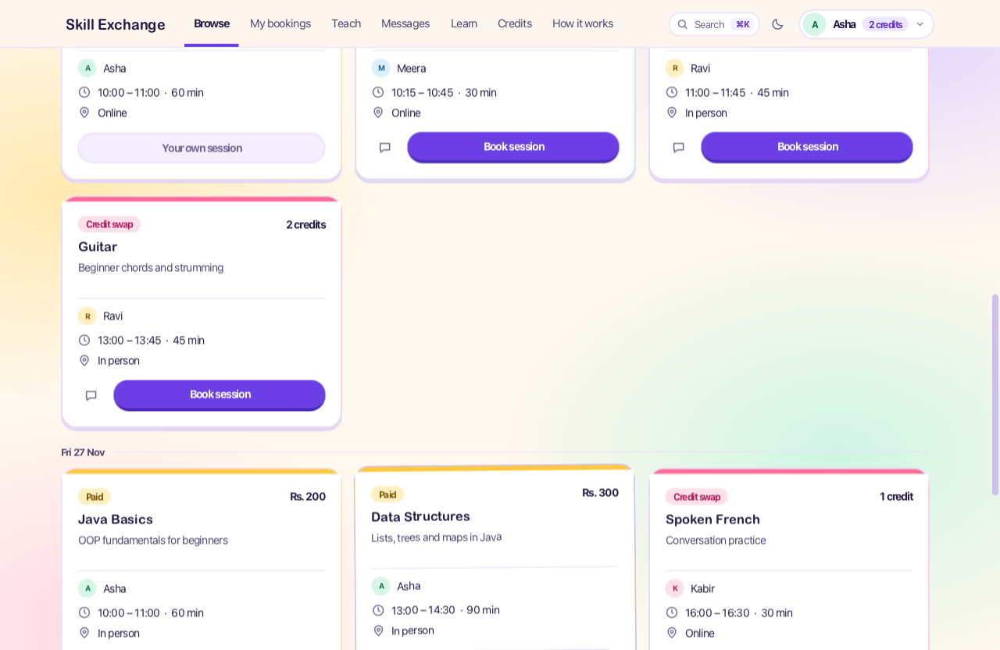
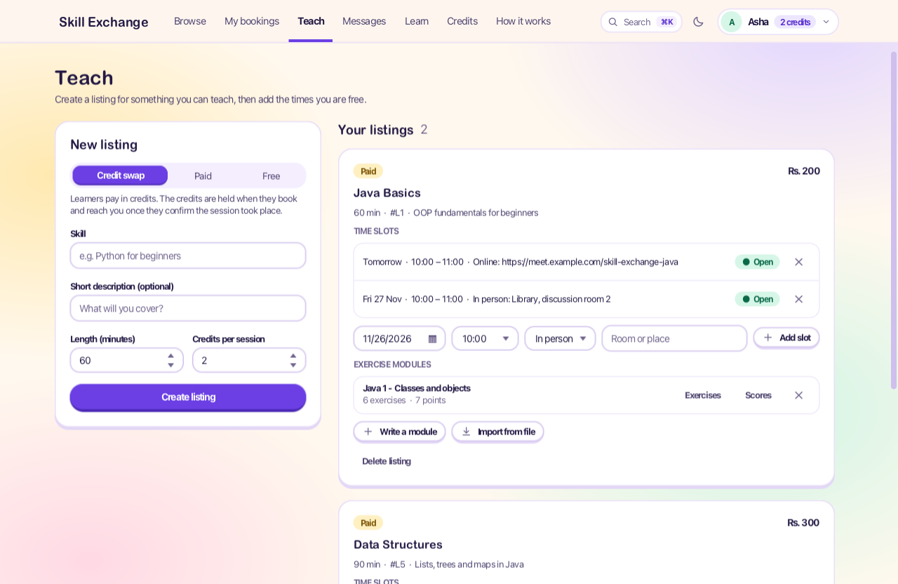
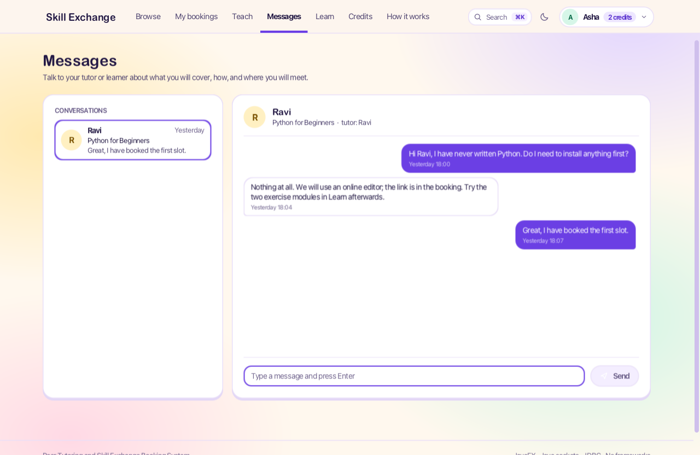
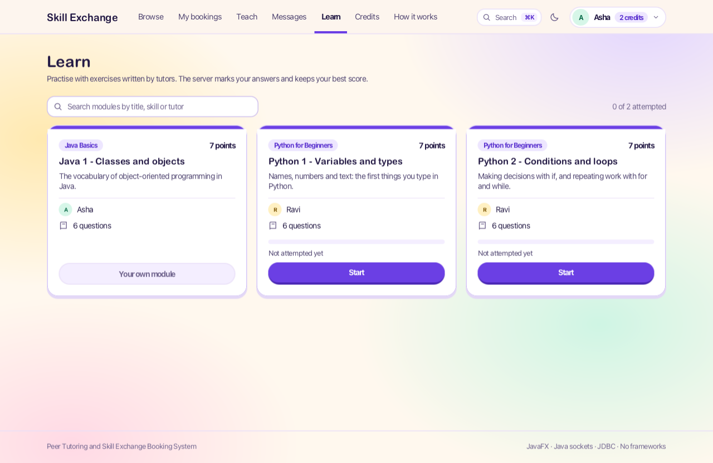
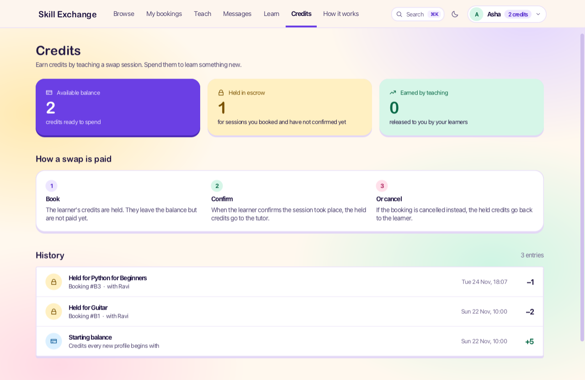
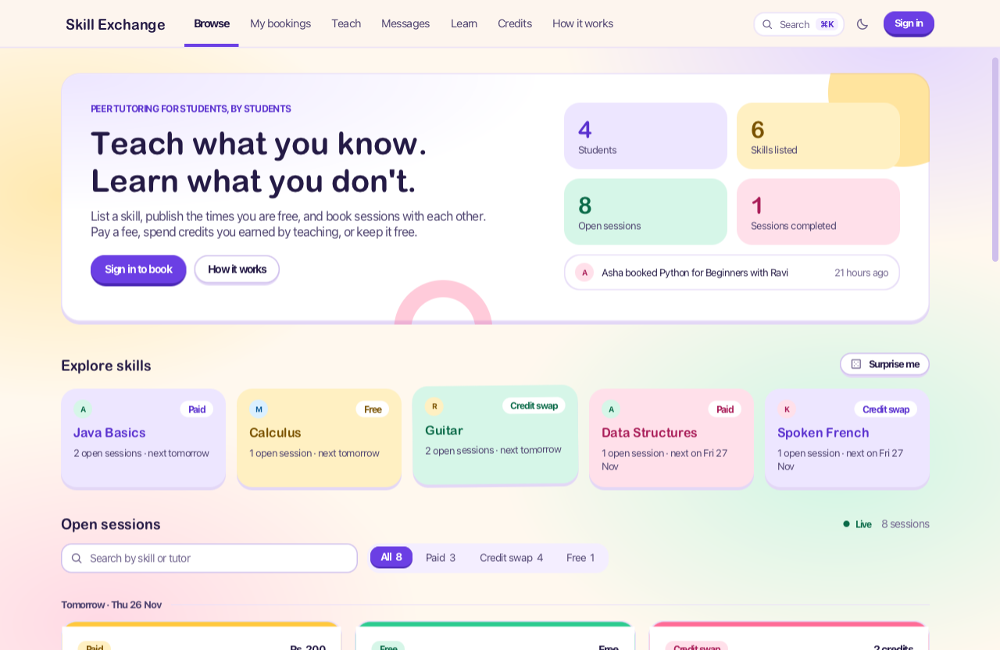

# Peer Tutoring and Skill Exchange Booking System

**UCS553 Enterprise Web Application** · Akshat Kaushik · Rudraksh Chugh

A booking system for peer tutoring, written entirely in Java. A student lists a skill, publishes
time slots, and other students book them. A session is **paid**, **free**, or a **credit swap**
paid with credits earned by teaching. Learner and tutor can **chat** to agree what, how and where,
and a tutor can attach **exercise modules** that the server marks.

It has three parts, all Java:

| Part | What it is | Main technology |
|---|---|---|
| Desktop client | The windows students use | JavaFX |
| Server (back end) | Enforces every rule, serves many clients at once | Sockets, thread pool, object serialization |
| Database | Where everything is stored | SQLite through JDBC |


## Run it

You need **JDK 17 or newer** and, the first time only, an internet connection (the Maven wrapper
downloads Maven, JavaFX, the SQLite driver and JUnit).

| To start | macOS / Linux | Windows |
|---|---|---|
| The desktop application | `./run.sh` | `run.bat` |
| Only the server | `./run.sh server` | `run.bat server` |
| The concurrency demo in the terminal | `./run.sh demo` | `run.bat demo` |
| The 54 JUnit tests | `./run.sh test` | `run.bat test` |

`./run.sh` on its own is enough: if no server is running on this computer, the application starts
one inside itself. The first run creates `data/skillexchange.db` and loads demo data.

**Demo accounts** (password `demo1234` for all): `asha@uni.edu`, `ravi@uni.edu`, `meera@uni.edu`,
`kabir@uni.edu`. Or create your own account on the sign-in screen.

**To see two students interact**, start the server once and the application twice:

```
./run.sh server        # terminal 1: type help, stats, clients, backup or quit
./run.sh               # terminal 2: sign in as asha@uni.edu
./run.sh               # terminal 3: sign in as ravi@uni.edu
```

Send a chat message in one window and it appears in the other at once. Book a slot in one window
and it disappears from the other's list.

Options: `./run.sh server --port 6000 --data mydata --reset` (`--reset` deletes the saved data),
`./run.sh app --host=192.168.1.20 --port=6000` to connect to a server on another computer.

Without the scripts: `./mvnw javafx:run` (application), `./mvnw compile exec:java` (server),
`./mvnw test` (tests).

## Deploy it

This is a desktop application with a server, not a website, so there is no single link to open.
Deploying it means two things: run the server on a computer everyone can reach, and give each
student the application.

**1. Build one file that holds everything**

```
./run.sh package          (Windows: run.bat package)
```

This creates `target/skill-exchange.jar` (about 23 MB). It needs only Java 17 or newer to run,
and holds the JavaFX libraries for Windows, Linux and Macs with Apple silicon. On an Intel Mac,
run from source with `./run.sh` instead.

**2. Start the server** on the computer that will keep the data:

```
java -jar skill-exchange.jar server
```

It listens on port 5050 and keeps its database, logs and backups in a `data` folder next to it.
Options: `--port 6000`, `--data folder`, `--reset`.

**3. Start the application** on each student's computer, pointing at the server:

```
java -jar skill-exchange.jar --host=192.168.1.20
```

| Where the server runs | What students use as `--host` | Notes |
|---|---|---|
| The same computer (a demo) | nothing: `java -jar skill-exchange.jar` | The application starts its own server if none is running. |
| A laptop on the same Wi-Fi | that laptop's IP address | Its firewall must allow incoming connections on port 5050. |
| A computer with a public address, such as a cloud virtual machine | its address | Open TCP port 5050. The connection is not encrypted, so see Limitations. |

The project's earlier web version was hosted on Render. That does not work for this version:
a Render web service receives HTTP requests, and this server speaks its own protocol over a plain
TCP socket.

Tested: all three commands on one Mac. Not tested: two different computers, and the JAR on
Windows and Linux.

## What a student can do

The interface keeps the design of the project's earlier web version (cream page, colour blobs,
chunky pill buttons, light and dark themes), rebuilt entirely from JavaFX nodes.

| Page | What it does |
|---|---|
| Browse | The home page. Numbers, recent bookings, skills on offer, and every open session as a card. Search, filter by type, book, message the tutor, or open a tutor's profile. Visitors can look around without an account. |
| Sign in | A dialog with email and password, the four demo students, and a create-profile form. Every field is checked while you type. |
| My bookings | Sessions as learner and as tutor, with a live countdown, where to meet, and what is happening to the credits. Cancel, confirm that a session took place, message, export as CSV. |
| Teach | Create a listing, publish time slots (online link or room), write or import exercise modules, see learners' scores. |
| Messages | Live chat between a learner and a tutor. |
| Learn | Take a module's exercises (multiple choice, true/false, fill in the blank) and get marked at once. |
| Credits | Balance, credits held in escrow, how a swap is paid, and the full history. |
| How it works | The main ideas, and the live concurrency test with one lane per thread. |

Also: a search dialog (Ctrl+K, or Cmd+K on a Mac), a light and a dark theme (the moon button; the
choice is remembered), and "Surprise me", which opens a random session you could book.

| | |
|---|---|
|  |  |
|  |  |
|  |  |
|  |  |
|  |  |
|  |  |

The pictures are taken by the application itself (`./run.sh app --shots=docs/screenshots`), which
drives the real screens with the demo account.

## How it is built

```
 JavaFX client (ui)                         Server (server)                       Database
 ------------------                         ---------------                       --------
 event handler                              ServerSocket + thread pool
   -> api.book(slotId)                        one ClientHandler per connection
        |                                        | reflection: Method.invoke
   dynamic proxy (net.RemoteApi)                 v
        |  Frame.Call  ---- socket ---->    ApiSession  (who is signed in)
        |  Frame.Reply <--- socket -----         |
        |  Frame.Push  <--- socket -----    service layer: rules, lock, transaction
   Platform.runLater -> update screen            |
                                            persistence: DAOs, PreparedStatement  -> SQLite file
```

| Package | Files | Job |
|---|---|---|
| `skillexchange.ui` | 18 | JavaFX pages, dialogs and the stylesheet's building blocks. No business rules. |
| `skillexchange.api` | 3 | `SkillExchangeApi`, the interface both sides share; `Event`; the `@Open` annotation |
| `skillexchange.net` | 2 | The wire format (`Frame`) and the client's proxy (`RemoteApi`) |
| `skillexchange.server` | 5 | Socket server, one handler per client, event hub, admin console |
| `skillexchange.service` | 9 | Every rule: bookings, credit ledger, accounts, chat, learning, demo data, race demo |
| `skillexchange.persistence` | 13 | `Database` (transactions) and one Data Access Object per table |
| `skillexchange.model` | 29 | The things the system is about. All serializable, so they can cross the network. |
| `skillexchange.validation` | 1 | `Validator`: one set of input rules used by the client and the server |
| `skillexchange.exception` | 11 | The custom exception hierarchy |
| `skillexchange.io` | 3 | Module file reader, CSV writer, serialized backup |
| `skillexchange.logging` | 2 | `java.util.logging` set-up and a custom formatter |

97 source files, about 8,200 lines, plus 5 test classes.

### What stops a slot being booked twice

Each client is served by its own thread, so two bookings for the same slot can run at the same
moment. Three things together prevent a double booking (`service/BookingService.java`):

1. **A lock.** Methods that change data hold the write lock of a `ReentrantReadWriteLock`, so
   "is it free?" and "mark it booked" are one step.
2. **A transaction.** The booking row, the slot, the credit balance and the ledger entry are
   committed together. If the learner cannot afford it, everything is rolled back.
3. **A UNIQUE index** in the database that refuses a second confirmed booking of one slot.

`./run.sh demo` shows the difference: 8 threads book one slot 8 times without a lock, and exactly
once through the service, in each of 200 repeats. The How it works page runs the same test live.

### Credits are held in escrow

| Action | Ledger entry | Effect |
|---|---|---|
| Learner books a swap session | `HOLD` | Credits leave the learner's balance and are held against the booking |
| Learner confirms it took place | `RELEASE` | The held credits are added to the tutor's balance |
| Booking is cancelled | `REFUND` | The held credits go back to the learner |

So a tutor is paid only for sessions that happen, and a refund can never fail.

## Course topics and where each one is used

| Unit | Topic | Where in the code |
|---|---|---|
| 1 | JDK, `main`, command-line arguments | `Launcher`, `server/ServerMain` (`--port`, `--data`, `--reset`), `ui/App` (`--host=`) |
| 2 | Packages, classes, constructors, `this` | 12 packages; validating constructors in `model/Listing`, `model/Student` |
| 3 | Overloading, access control, `static`, `final` | Two `Student` constructors; `ModuleFileParser.parse(Path)` and `parse(BufferedReader)`; package-private DAOs' base class `persistence/Dao` |
| 4 | Inheritance, abstract classes | `Listing` (abstract) with `PaidListing`, `CreditSwapListing`, `FreeListing`; `Dao` (abstract) |
| 4 | Interfaces | Our own: `SkillExchangeApi`, `Repository<T>`, `Exercise` (constant, default and static methods, nested enum), `ui/View` |
| 4 | Nested classes, varargs | Inner class `MessagesView.Bubble`; static nested `ModuleFileParser.Pending`; nested interface `EventHub.Sink`; anonymous classes in `ui/Ui`, `ui/FormField`, `ui/SignIn`; varargs in `Dao.list(...)` |
| 5 | Conventions, build tools | Maven: `pom.xml`, `src/main/java`, `src/test/java`, the Maven wrapper |
| 6 | Exceptions | Checked hierarchy under `SkillExchangeException`; unchecked `DataAccessException`; chaining in `Database.inTransaction`; multi-catch in `TeachView.writeModule`; `finally` in `BookingService.change` |
| 7 | Collections, generics, utility classes | `LinkedHashMap`, `HashSet`, `EnumMap`, `ArrayDeque`, `ConcurrentHashMap`; explicit `Iterator` in `EventHub.deliver`; `Comparator` in `LearnView`; `Collectors.groupingBy` in `BrowseView`; generic interface `Repository<T>`, generic methods in `Dao`; `Optional` returned by every `findById` |
| 8 | File handling | Reads text: `io/ModuleFileParser`, `Database.readStatements`. Writes text: `io/SessionCsv`. Bytes: `io/Backup`. All with try-with-resources. |
| 9 | Serialization | Every call and reply crosses the socket as a serialized `Frame`; `transient` password fields in `Student`; `serialVersionUID`; `io/Backup` keeps shared references |
| 10 | Logging | `logging/LogConfig`: `Logger` per class, levels, `ConsoleHandler`, two `FileHandler`s, a custom `Formatter`, a `Filter` for the audit log |
| 11 | JDBC | `persistence/`: `DriverManager`, `PreparedStatement`, `ResultSet`, generated keys, a batch insert, transactions with commit and rollback, the DAO pattern |
| 12 | JavaFX GUI | `ui/App` (`init`, `start`, `stop`), `Stage` and `Scene`, a second modal `Stage` (`QuizWindow`), `BorderPane`, `GridPane`, `HBox`, `VBox`, `StackPane`, shapes and `SVGPath` icons, a JavaFX stylesheet |
| 13 | JavaFX events | Event handlers as anonymous class (`SignIn`) and lambda, key events and an event filter (`MainView`), `ChangeListener`, property bindings, input validation (`FormField`), an `Alert` for connection errors (`Ui.alert`), in-window dialogs (`Modal`), notifications (`MainView.toast`), animations (`Timeline`, transitions), the sign-in form |

### Beyond the slide decks

| Topic | Where |
|---|---|
| Multithreading | `ExecutorService`, `ScheduledExecutorService`, `ReentrantReadWriteLock`, `synchronized`, `volatile`, `CountDownLatch`, `Semaphore`, `AtomicInteger`, `CompletableFuture`, `CopyOnWriteArrayList`; JavaFX `Task` and `Platform.runLater` |
| Networking | `ServerSocket` and `Socket` (`server/SkillExchangeServer`, `net/RemoteApi`) |
| Reflection | Dynamic proxy in `net/RemoteApi`; `Method.invoke` in `server/ClientHandler` |
| Custom annotation | `api/Open`, read at run time to decide which methods need sign-in |
| Records, sealed interfaces | `Frame`, `Event`, `Exercise` and most of `model/` |
| Lambdas, streams, method references | Throughout, for example `CreditsView.show` and `LearningService.questions` |
| Security | Passwords stored as salted PBKDF2 hashes (`model/Passwords`); a deserialization filter in `ClientHandler`; SQL only through `PreparedStatement` |
| Preferences | `java.util.prefs.Preferences` remembers the chosen theme (`ui/App`) |
| Unit tests | JUnit 5, 54 tests in `src/test/java` |

## Input validation

All rules are in `validation/Validator.java`. The forms use them while you type, and the server
applies the same rules again before storing anything.

| Field | Rule |
|---|---|
| Email | Required. One `@`, no spaces, dots cannot start, end or repeat, a real-looking domain. Stored in lower case and **unique** (also enforced by the database). |
| Password | 8 to 64 characters, at least one letter and one number. Five wrong attempts pause sign-in for that email for 30 seconds. |
| Name | 2 to 40 characters: letters, spaces, dots, hyphens, apostrophes. |
| Skill / description | 2 to 40 characters / at most 300. |
| Duration, fee, credits | 15 to 240 minutes; Rs. 1 to 100,000; 1 to 10 credits. |
| Slot | In the future and within a year. Online needs an `http(s)://` link, in person needs a room. |
| Message | 1 to 1,000 characters. |
| Module | Title 2 to 60 characters, 1 to 30 exercises, each with a question of 5 to 300 characters and 1 to 10 points. |

## Writing exercise modules

A tutor writes a module in the Teach screen or imports a `.txt` file in this format
(`src/main/resources/modules/python-basics.txt` is a full example):

```
MODULE: Python 1 - Variables and types
SUMMARY: Names, numbers and text.

MCQ: Which of these is a valid Python variable name?
- 2cool
* cool_2
- cool-2
POINTS: 2

TF: Indentation is optional in Python. => false

FILL: The keyword that means "else if" is ____. => elif
```

The line starting with `*` is the right option. `POINTS:` is optional and belongs to the question
above it. A mistake is reported with its line number. Answers never leave the server: a learner
receives the questions only, and the server does the marking.

## Tests

`./run.sh test` runs 54 tests against real SQLite databases in temporary folders:

| Test class | What it proves |
|---|---|
| `ValidatorTest` | Good and bad emails, passwords, names, links, ranges |
| `BookingServiceTest` | Every booking rule, the escrow ledger, and that a failed booking is rolled back completely |
| `LearningAndChatTest` | Marking, best scores, and that a chat is private to its two students |
| `FilesTest` | The module file parser, CSV escaping, and that a backup keeps shared references but not passwords |
| `ClientServerTest` | A real server and real socket clients: sign-in is required, exceptions cross the network, chat is pushed, the race has one winner in all 200 repeats |

## Limitations

- **No real payment.** A paid listing records a fee; nothing is collected.
- **The connection is not encrypted.** Client and server talk over plain TCP, so use it on a trusted network. TLS would be the fix.
- **An email address is checked for format and uniqueness, not ownership.** No confirmation mail is sent, and there is no password reset.
- **One time zone.** Times are the local times of the computer the server runs on.
- **SQLite allows one writer at a time.** That suits a college-sized system, not a large one.
- **Client and server must be the same version**, because objects travel by Java serialization.
- **A server started by a window stops when that window closes.** For several users, start the server separately.
- **Not used from the course:** `CallableStatement` (SQLite has no stored procedures) and `DataInputStream`/`DataOutputStream`.
- The look of the screens comes from `src/main/resources/ui/app.css`. It is a JavaFX stylesheet applied to JavaFX controls; there is no HTML or JavaScript in the project.
- **The headings use the system's rounded typeface where there is one** (Arial Rounded on macOS). The earlier web version used the Nunito font, which is not bundled.

## Project layout

```
pom.xml                         Maven build: dependencies, plugins, the single-JAR packaging
run.sh, run.bat                 start scripts (app, server, demo, test, package)
mvnw, mvnw.cmd, .mvn/           Maven wrapper
src/main/java/skillexchange/    the application (see the package table above)
src/main/resources/db/          schema.sql
src/main/resources/modules/     demo exercise modules
src/main/resources/ui/          app.css
src/test/java/skillexchange/    JUnit tests
docs/screenshots/               pictures taken by the application
data/                           created at run time: database, logs, backups (not in git)
```
