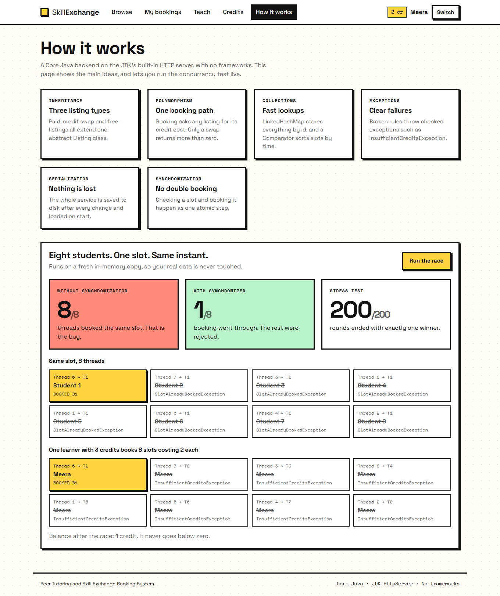
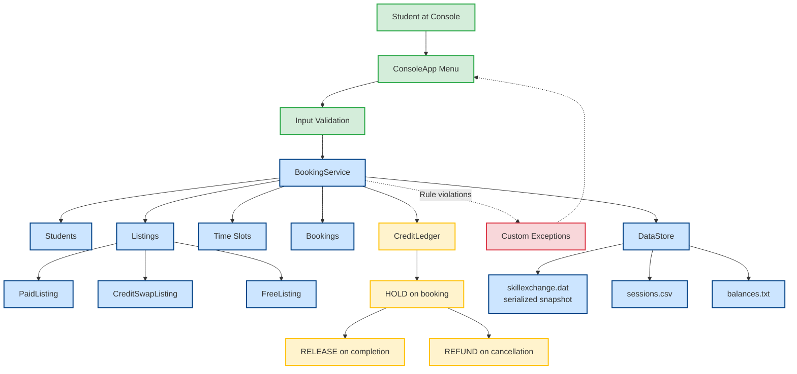

<p align="center">
  <h1 align="center">Peer Tutoring & Skill Exchange Booking System</h1>
  <p align="center">
    <strong>A Core Java console application where students teach what they know, book what they want to learn, and pay with money, swap credits, or nothing at all.</strong>
  </p>
  <p align="center">
    
    
    
    
    
  </p>
</p>

---

## Overview

Students often know something worth teaching, like Java, guitar, calculus or a language, and want to learn something else in return. This system lets a student **list a skill** and publish **time slots** for it. Other students can **browse, search and book** a session.

Each listing is one of three types:

| Listing type | How the learner pays |
|---|---|
| **Paid** | A fee in rupees (e.g. `Rs. 200.00`) |
| **Credit Swap** | Skill-exchange credits, earned by teaching others |
| **Free** | Nothing (volunteer session) |

> **Key Differentiator:** Swap sessions use an **escrow-based credit ledger**. When a learner books, their credits are *held*, not paid. The tutor receives them only after the learner confirms the session took place. If the booking is cancelled, the credits are refunded. Tutors are only paid for sessions that actually happen, and a refund can never fail because the tutor already spent the credits.

---

## Screenshots

The web front end, served by the JDK's built-in HTTP server:

<p align="center">
  
</p>

The **How it works** page runs the concurrency test live. Without synchronization all 8 threads book the same slot; with it, exactly one does:

<p align="center">
  
</p>

---

## System Architecture



---

## Core Java Concepts Demonstrated

| Concept | Where | How it is used |
|---|---|---|
| **Inheritance** | `model/Listing.java` and its 3 subclasses | Abstract `Listing` holds the shared fields. `PaidListing`, `CreditSwapListing` and `FreeListing` extend it |
| **Polymorphism** | `Listing.getCreditCost()`, `getPriceDescription()` | `BookingService.book()` charges credits through `getCreditCost()` and never checks the listing type |
| **Encapsulation** | All model classes | Final fields and validating constructors. Only the service changes booking state |
| **Collections** | `service/BookingService.java` | `LinkedHashMap` stores data by id, `ArrayList` holds results, a `Comparator` sorts slots by time, and `HashMap` stores ledger balances |
| **Custom Exceptions** | `exception/` | A checked hierarchy: `BookingException` → `SlotAlreadyBooked`, `BookingConflict`, `InsufficientCredits`, plus `PersistenceException` |
| **File Handling** | `persistence/DataStore.java` | `PrintWriter`/`BufferedWriter` export a CSV session history and a text credit report |
| **Serialization** | `persistence/DataStore.java` | `ObjectOutputStream` saves the whole `BookingService` object to disk, and `ObjectInputStream` restores it |
| **Multithreading** | `ConcurrencyDemo.java` | `ExecutorService`, `CountDownLatch`, `Future` and `AtomicInteger` simulate students booking at the same moment |
| **Synchronization** | `BookingService`, `CreditLedger` | `synchronized` methods make "check, then book" one atomic step, and `volatile` fields keep booking state visible to every thread |
| **Enums** | `BookingStatus`, `CreditTransaction.Type` | Booking life cycle and ledger entry types |

---

## Booking Rules

The service enforces every rule, and each violation throws a specific exception:

| Rule | Exception |
|---|---|
| A slot can only be booked once | `SlotAlreadyBookedException` |
| You cannot book your own session | `BookingConflictException` |
| A learner cannot attend two sessions at the same time | `BookingConflictException` |
| A learner cannot book a session while they are teaching | `BookingConflictException` |
| A tutor's slots cannot overlap | `BookingConflictException` |
| A swap booking needs enough credits | `InsufficientCreditsException` |
| Only the learner or the tutor can cancel a booking | `BookingException` |
| Only the learner can confirm a session (this pays the tutor) | `BookingException` |

Every check runs **before** any state changes, so a failed booking leaves nothing half-done.

---

## Credit Ledger (Escrow)

```text
Learner books a swap session    ->  HOLD     learner -2   (credits leave the learner's balance)
Learner confirms it took place  ->  RELEASE  tutor   +2   (tutor is paid)
        or
Booking is cancelled            ->  REFUND   learner +2   (credits come back)
```

Every movement is recorded as a `CreditTransaction` with a timestamp. The history is shown in the app and exported to `data/balances.txt`.

---

## Concurrency Results

`ConcurrencyDemo` releases 8 threads at the same instant using a `CountDownLatch`:

| Scenario | Without synchronization | With `synchronized` |
|---|---|---|
| 8 students book the **same slot** | **Slot booked 8 times** | 1 booked, 7 × `SlotAlreadyBookedException` |
| 1 learner with 3 credits books **8 different 2-credit slots** | n/a | 1 booked, 7 × `InsufficientCreditsException`, balance never negative |
| Same-slot race repeated **200 rounds** | n/a | **200/200 rounds with exactly one winner** |

Locks are always taken in the order service → ledger, and the ledger never calls back into the service, so there is no possibility of deadlock.

---

## Repository Structure

```text
├── src/skillexchange/
│   ├── Main.java                  # Entry point: load data, seed demo data, start menu
│   ├── DemoData.java              # Sample students, listings and slots for the first run
│   ├── ConcurrencyDemo.java       # Race condition vs. synchronized booking
│   ├── model/
│   │   ├── Student.java
│   │   ├── Listing.java           # Abstract base class
│   │   ├── PaidListing.java
│   │   ├── CreditSwapListing.java
│   │   ├── FreeListing.java
│   │   ├── TimeSlot.java
│   │   ├── Booking.java
│   │   ├── BookingStatus.java
│   │   └── CreditTransaction.java
│   ├── service/
│   │   ├── BookingService.java    # All booking rules, thread-safe
│   │   └── CreditLedger.java      # Escrow credit balances and history
│   ├── exception/                 # Custom checked exceptions
│   ├── persistence/
│   │   └── DataStore.java         # Serialization + CSV/text exports
│   ├── ui/
│   │   ├── ConsoleApp.java        # Menu (no business logic)
│   │   └── Input.java             # Validated console input
│   └── web/
│       ├── WebServer.java         # JSON API + static files on the JDK HttpServer
│       ├── RaceDemo.java          # Concurrency race for the web page
│       └── Json.java              # Minimal JSON writer
├── web/                           # Front end: index.html, styles.css, app.js
├── data/                          # Created at runtime (saved state and reports)
├── out/                           # Compiled classes
└── README.md
```

---

## Quick Start

### 1. Requirements
- JDK 17 or newer (the code uses switch expressions, `instanceof` patterns and `Stream.toList()`). It was developed and tested only on **Java 26**.
- No build tool or external libraries

### 2. Compile
```powershell
javac -d out (Get-ChildItem -Recurse src -Filter *.java).FullName
```
On macOS/Linux:
```bash
javac -d out $(find src -name "*.java")
```

### 3. Run the App
```bash
java -cp out skillexchange.Main
```
On the first run, demo data is loaded. Log in as **S1 to S4** (Asha, Ravi, Meera, Kabir) or register a new student. New students start with **5 credits**.

To delete saved data and start fresh:
```bash
java -cp out skillexchange.Main --reset
```

### 4. Run the Concurrency Demo
```bash
java -cp out skillexchange.ConcurrencyDemo
```

### 5. Run the Web App
```bash
java -cp out skillexchange.web.WebServer            # then open http://localhost:8080
java -cp out skillexchange.web.WebServer --reset    # start fresh with demo data
java -cp out skillexchange.web.WebServer 9090       # use another port
```
Run it from the project root so it can find the `web/` folder. The web app and the console app share the same `data/` folder, so run one at a time.

The web front end is built on the JDK's own `com.sun.net.httpserver`, so it still needs no frameworks or libraries. It has screens to browse and book slots, manage your bookings, create listings and time slots, and view your credit history. The **How it works** page runs the concurrency race live in the browser.

---

## Using the App

```text
--- Priya (S5) | 5 credits ---
 1. Browse open slots
 2. Search listings by skill
 3. Book a slot
 4. My bookings
 5. Cancel a booking
 6. Confirm a session took place (pays the tutor)
 7. Create a listing (teach a skill)
 8. Add a time slot to my listing
 9. My listings and slots
10. Credit balance and history
 0. Log out
```

Sample session:

```text
Slot id to book (blank to go back): T9
Book Python with Ravi for 3 credits? (y/n): y
Booked! Booking B3: Priya -> Python on 2026-11-05 [CONFIRMED]
Held until you confirm the session took place: 3 credits

Slot id to book (blank to go back): T7
Book Spoken French with Kabir for 1 credit? (y/n): y
Could not book: Priya needs 1 credit but has only 0
```

---

## Data Files

All data is stored in `data/` and saved automatically after every change:

| File | Format | Purpose |
|---|---|---|
| `skillexchange.dat` | Java serialization | The full application state, loaded on startup |
| `sessions.csv` | CSV | Session history (opens in Excel) |
| `balances.txt` | Text | Credit balance and transaction history for each student |

Saving writes to a temporary file first and then renames it over the real file, so a crash mid-save cannot damage the previous save.

> After changing the fields of any model class, run with `--reset`, because older `.dat` files cannot be loaded into changed classes.

---

## Academic Note
This project was built as a semester Core Java project to demonstrate object-oriented design, collections, exception handling, file I/O, serialization and multithreading. It is a learning project and not a production booking platform.
